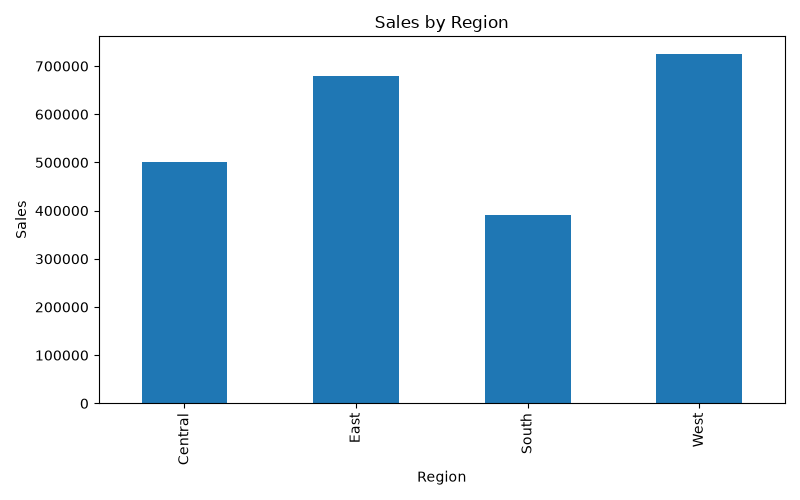
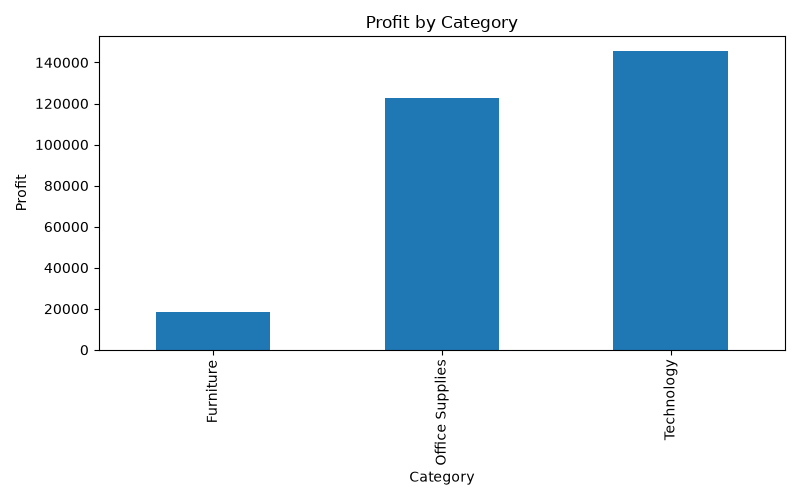
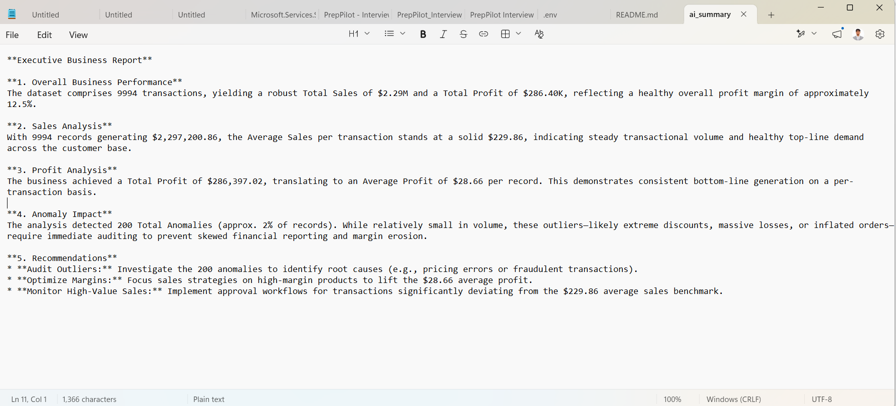
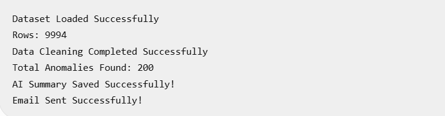

# 🤖 AI Business Anomaly Detection


## 📌 Project Overview

AI Business Anomaly Detection is a Python-based Machine Learning project that analyzes business transactions and identifies unusual records using the **Isolation Forest algorithm**.

The project combines data cleaning, exploratory data analysis (EDA), data visualization, anomaly detection, Gemini AI-powered business summaries, and automated email alerts.

## 🎯 Project Objectives

* Load and preprocess business transaction data.
* Perform Exploratory Data Analysis (EDA).
* Analyze sales and profit across business categories and regions.
* Detect unusual transactions using Machine Learning.
* Generate business summaries using Gemini AI.
* Send automated email reports.
* Export processed datasets and reports.

## 📸 Project Screenshots

### 1. Sales by Region


### 2. Profit by Category


### 3. Gemini AI Business Summary


### 4. Project Execution Output


## 🛠️ Technologies Used

* Python 3.12
* Pandas
* NumPy
* Matplotlib
* Seaborn
* Scikit-Learn
* Google Gemini API
* SMTP / Gmail
* python-dotenv
* Flask
* Plotly
* ReportLab

## 🌌 ANOMALY INTELLIGENCE Web Application

The Flask dashboard wraps the existing Python analysis modules. Upload a CSV to explore its columns and data quality, clean it, run exploratory analysis and Isolation Forest, view interactive Plotly charts, generate a Gemini summary, download cleaned/anomaly CSVs and analysis TXT/PDF reports, or send a report through Gmail SMTP. Each upload has a separate workspace and generated artifacts.

Uploads are stored locally under the ignored `instance/datasets/` directory. The web application accepts CSV files up to 32 MB. Gemini and email features require their respective environment variables; the rest of the analysis works without external API credentials.

## 🧠 Machine Learning Algorithm

### Isolation Forest

Isolation Forest is an unsupervised Machine Learning algorithm used to identify unusual observations in a dataset.

The model analyzes selected business features and identifies records that differ significantly from normal transaction patterns.

**Features used:**

* Sales
* Profit
* Quantity
* Discount

**Model configuration:**

```python
IsolationForest(
    n_estimators=100,
    contamination=0.02,
    random_state=42
)
```

## 📊 Exploratory Data Analysis

The project performs:

* Dataset shape and data type analysis
* Missing value analysis
* Duplicate record detection
* Summary statistics
* Category distribution
* Regional sales analysis
* Profit analysis

## 📈 Data Visualizations

The project automatically generates:

* Sales by Region
* Profit by Category

The generated graphs are saved in the `reports/` directory.

## 🤖 Gemini AI Business Summary

The project integrates Google's Gemini API to generate an AI-powered business report.

The report includes:

* Overall business performance
* Sales analysis
* Profit analysis
* Anomaly overview
* Business recommendations

## 📧 Automated Email Alerts

The project uses Gmail SMTP to send the generated business summary through email.

Email credentials are stored in a local `.env` file and are not included in the public repository.

## 📂 Project Structure

```text
AI-Business-Anomaly-Detection/
│
├── data/
│   ├── raw/
│   │   └── business_data.csv
│   │
│   └── processed/
│       ├── cleaned_data.csv
│       └── anomalies.csv
│
├── reports/
│   ├── sales_by_region.png
│   ├── profit_by_category.png
│   ├── summary.txt
│   └── ai_summary.txt
│
├── src/
│   ├── data_loader.py
│   ├── data_cleaning.py
│   ├── eda.py
│   ├── visualization.py
│   ├── anomaly_detection.py
│   ├── ai_summary.py
│   ├── gemini_summary.py
│   ├── email_alert.py
│   └── main.py
│
├── requirements.txt
├── README.md
└── .gitignore
```

## 📋 Project Results

Tested on a business transaction dataset.

| Metric             |        Result |
| ------------------ | ------------: |
| Total Records      |         9,994 |
| Total Sales        | $2,297,200.86 |
| Total Profit       |   $286,397.02 |
| Average Sales      |       $229.86 |
| Average Profit     |        $28.66 |
| Detected Anomalies |           200 |
| Anomaly Percentage |            2% |

**Note:** The anomaly percentage is based on the Isolation Forest contamination setting. Detected anomalies require further investigation and should not automatically be considered fraudulent transactions.

## ⚙️ Installation and Setup

### 1. Clone the Repository

```bash
git clone https://github.com/theshubham1508-alt/AI-Business-Anomaly-Detection.git
```

### 2. Open the Project Directory

```bash
cd AI-Business-Anomaly-Detection
```

### 3. Create a Virtual Environment

```bash
python -m venv venv
```

Activate it on Windows:

```powershell
.\venv\Scripts\Activate.ps1
```

### 4. Install Dependencies

```bash
pip install -r requirements.txt
```

### 5. Configure Environment Variables

Create a `.env` file in the project root directory:

```env
GEMINI_API_KEY=your_gemini_api_key
SENDER_EMAIL=your_gmail_address
EMAIL_APP_PASSWORD=your_gmail_app_password
RECEIVER_EMAIL=optional_default_recipient
FLASK_SECRET_KEY=generate_a_long_random_secret
```

Get your Gemini API key from Google AI Studio.

**Important:** Never upload your `.env` file or expose API keys and email passwords on GitHub.
Generate a persistent Flask session key with `python -c "import secrets; print(secrets.token_hex(32))"` and use the printed value for `FLASK_SECRET_KEY`. Keep it private; sessions will reset after restart if this setting is omitted.

For Gmail, use a Google App Password. The web dashboard lets you enter a recipient address when sending a report; `RECEIVER_EMAIL` remains available as the default for the command-line workflow.

### 6. Run the Web Application

From the project root:

```powershell
python app.py
```

Open [http://127.0.0.1:5000](http://127.0.0.1:5000). To configure the bind address or port, set `FLASK_HOST` or `FLASK_PORT`. Debug mode is off by default; only enable `FLASK_DEBUG=true` for local development.

### 7. Run the Original Command-Line Workflow

```bash
python src/main.py
```

## 📁 Generated Outputs

After successful execution, the project generates:

* `cleaned_data.csv` – Cleaned business dataset.
* `anomalies.csv` – Transactions identified as anomalies.
* `sales_by_region.png` – Regional sales visualization.
* `profit_by_category.png` – Category-wise profit visualization.
* `summary.txt` – Basic business summary.
* `ai_summary.txt` – Gemini AI-generated business report.
* Email alert – Sends the generated summary to the configured recipient.

## 🚀 Future Improvements

* Power BI business intelligence dashboard.
* Real-time business anomaly monitoring.
* Comparison with other anomaly detection algorithms.
* Cloud deployment.
* Advanced anomaly investigation and reporting.

## 👨‍💻 Author

**Shubham**

Areas of Interest:

* Data Analytics
* Machine Learning
* Python
* Business Intelligence
* Data Science

## ⭐ Support

If you find this project useful, consider giving the repository a star!
